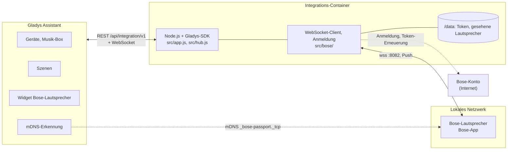
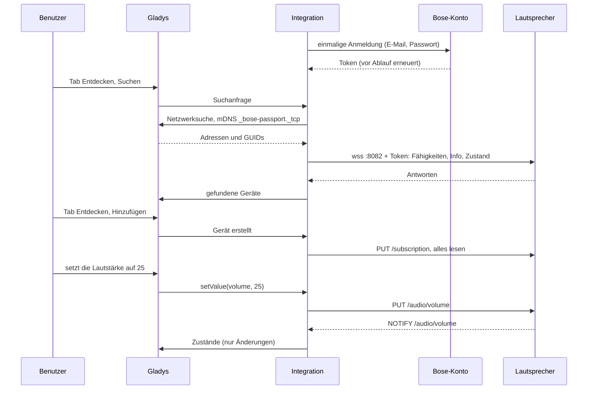

# Bose für Gladys Assistant

[English](README.md) | [Français](README.fr.md) | **Deutsch** | [Español](README.es.md)

[](LICENSE)
[](https://github.com/William-De71/gladys-bose/releases)
[](https://github.com/William-De71/gladys-bose/actions/workflows/release.yml)
[](https://gladysassistant.com)


Ihre aktuellen Bose-Smart-Lautsprecher und Soundbars (die mit der Bose-App eingerichteten) in Gladys Assistant, im lokalen Netzwerk gesteuert, ihre Änderungen in Echtzeit gemeldet. Betrieb, Lautstärke, Wiedergabe, Quellen und Voreinstellungen, Klangeinstellungen, Dialogmodus, Akku, Multiroom-Gruppen, ein Dashboard-Widget und Szenen. Inoffiziell, nicht mit Bose verbunden.

## Funktionen

- **Erkennung** über die mDNS-Suche von Gladys (`_bose-passport._tcp`); für Lautsprecher, die sie nicht erreicht, können IP-Adressen eingegeben werden. Jeder Lautsprecher wird über seine GUID erkannt und nach einem Adresswechsel wiedergefunden.
- **Ein Gerät pro Lautsprecher**: Ein/Standby, Lautstärke, Stumm, Wiedergabe, Pause, Zurück, Weiter, Wiedergabestatus (die Musik-Box des Dashboards), Quelle (TV, optisch, analog, AUX, Voreinstellungen), aktueller Titel, Interpret und je nach Modell Bass, Mitten, Höhen, Center, Surround, Höhe, Subwoofer, Dialogmodus, Akku und Lädt.
- **Gemeldete Zustände**: Die Lautsprecher melden jede Änderung über ihren lokalen WebSocket; nichts wird abgefragt (eine Erreichbarkeitsprüfung pro Minute).
- **Ein Dashboard-Widget**: der aktuelle Titel mit Cover, Status, Quelle, Lautstärke, Akku, Gruppe und die Tasten Zurück, Wiedergabe/Pause, Weiter, Standby.
- **Vier Szenen-Auslöser** (Wiedergabe gestartet, Wiedergabe beendet, Quelle gewechselt, Lautsprecher nicht erreichbar) und **drei Szenen-Aktionen** (Voreinstellung abspielen, Lautsprecher gruppieren, Lautsprecher aus der Gruppe nehmen).
- **Anmeldung beim Bose-Konto** und Token-Erneuerung durch die Integration (die Lautsprecher verlangen es), Passwort als Gladys-Geheimnis gespeichert, nie protokolliert.
- Englisch, Französisch, Deutsch und Spanisch.

**Welche Bose-Integration?** Diese ist für die Lautsprecher der **Bose-App** (früher Bose Music): Smart Soundbar, Smart Ultra Soundbar, Soundbar 550/700/900, Smart Speaker, Home Speaker 300/500, Portable Smart Speaker, Music Amplifier. Die ältere **SoundTouch**-Reihe (SoundTouch 10/20/30/300, Wave SoundTouch, mit der SoundTouch-App eingerichtet, lokale API auf Port 8090) wird von [Bose SoundTouch](https://github.com/guim31/gladys-soundtouch) von guim31 abgedeckt.

## Funktionsweise




Gladys durchsucht im Host-Netzwerk den mDNS-Dienst der Lautsprecher und leitet die Antworten weiter (Adresse und GUID): Der Container liegt hinter der Docker-Bridge, wo Multicast nie das Netzwerk erreicht. Die Integration öffnet dann den lokalen WebSocket jedes Lautsprechers (`wss://<Adresse>:8082`, Subprotokoll `eco2`, selbstsigniertes Zertifikat), liest seine Fähigkeiten und seinen Zustand und abonniert seine Änderungen. Jede Anfrage trägt das Token des Bose-Kontos, zu dem der Lautsprecher gehört: Bose lässt alles andere ablehnen. Dieses Token wird einmal bei der Bose-Cloud geholt (die Anmeldeseiten der Bose-App, dann der Bose-Token-Dienst) und vor Ablauf erneuert; kein Befehl und kein Zustand läuft über die Cloud.




### Geräte und Funktionen

| Funktion                                               | Kategorie / Typ                               | Werte                                                  |
| ------------------------------------------------------ | --------------------------------------------- | ------------------------------------------------------ |
| Ein/Standby, Stumm                                     | `switch` / `binary`                           | 0 / 1                                                  |
| Lautstärke                                             | `music` / `volume`                            | 0 bis 100                                              |
| Wiedergabe, Pause, Zurück, Weiter                      | `music` / `play`, `pause`, `previous`, `next` | Tasten                                                 |
| Wiedergabestatus                                       | `music` / `playback_state`                    | 1 bei Wiedergabe, sonst 0                              |
| Quelle                                                 | `text` / `select`                             | `other`, `tv`, `optical`, `analog`, `aux`, `preset-1`… |
| Aktueller Titel, Interpret                             | `text` / `text`                               | Text                                                   |
| Bass, Mitten, Höhen, Center, Surround, Höhe, Subwoofer | `text` / `select`                             | Rohwerte des Lautsprechers (−100…+100, Schritt 10)     |
| Dialogmodus                                            | `text` / `select`                             | Modi der Soundbar (`NORMAL`, `DIALOG`…)                |
| Akku, Lädt                                             | `battery` / `integer` (%), `charging`         | tragbare Lautsprecher                                  |

Externe ID des Geräts: `ext:<Selektor>:speaker:<GUID>`; Funktionen `…:power`, `…:volume`, `…:mute`, `…:play`, `…:pause`, `…:previous`, `…:next`, `…:playback-state`, `…:source`, `…:title`, `…:artist`, `…:bass`, `…:midrange`, `…:treble`, `…:center`, `…:surround`, `…:height`, `…:subwoofer`, `…:audio-mode`, `…:battery`, `…:charging`. Nur die Funktionen, die der Lautsprecher hat, werden deklariert (Lautsprecher listen ihre Klangeinstellungen nicht immer: Fehlende werden trotzdem mit kurzer Wartezeit abgefragt).

## Transport

`transports: ["local"]`: Befehle und Zustände laufen nur über Ihr lokales Netzwerk. Die Bose-Cloud wird für eine einzige Sache kontaktiert, das Konto-Token, das die Lautsprecher verlangen: eine Anmeldung mit E-Mail und Passwort, dann höchstens einmal pro Stunde eine Erneuerung. Das ist ein Authentifizierungsschritt, kein Kanal: Darüber lässt sich nichts steuern, daher deklariert die Integration keinen `cloud`-Transport und Gladys zeigt keine Schaltfläche „Lokale Verbindung bevorzugen“. Jeder Lautsprecher zeigt ein Abzeichen **lokal** oder **nicht erreichbar**, wenn er nicht antwortet.

## Widgets


- **Bose-Lautsprecher**: ein in den Einstellungen gewählter Lautsprecher: der aktuelle Titel und sein Cover (wenn der Musikdienst eines unter 300 KB liefert), Status, Quelle, Lautstärke, Akku, Gruppe und die Tasten **Zurück**, **Abspielen** / **Pause**, **Weiter**, **Standby** (**Einschalten** im Standby).

Die Bilder erzeugt `docs/illustrations/render.sh` aus dem echten Widget-Code: Es sind Illustrationen, keine Screenshots (das Cover ist für die Illustration gezeichnet).

## Szenen-Auslöser und -Aktionen

| Auslöser              | Filter                    | Variablen                                                 |
| --------------------- | ------------------------- | --------------------------------------------------------- |
| `playback_started`    | Lautsprecher              | `device_name`, `title`, `artist`, `source`                |
| `playback_stopped`    | Lautsprecher              | `device_name`, `title`, `artist`, `source`                |
| `source_changed`      | Lautsprecher, neue Quelle | `device_name`, `source`, `source_name`, `previous_source` |
| `speaker_unreachable` | Lautsprecher              | `device_name`, `address`                                  |

| Aktion            | Felder                                         | Ausgaben      |
| ----------------- | ---------------------------------------------- | ------------- |
| `play_preset`     | Lautsprecher, Voreinstellung 1 bis 6           | `preset_name` |
| `group_speakers`  | Hauptlautsprecher, hinzuzufügende Lautsprecher | `group_size`  |
| `ungroup_speaker` | Lautsprecher                                   | keine         |

Ein Ereignis pro vom Lautsprecher gemeldetem Übergang; keines in den fünf Sekunden nach einer Szenenaktion auf ihm. Beispiele:

- Werktags um 7 Uhr → **Voreinstellung auf einem Bose-Lautsprecher abspielen** (Küche, Voreinstellung 1), dann die Lautstärke auf 25.
- **Ein Bose-Lautsprecher wechselt die Quelle** zu `tv` → Wohnzimmerlicht dimmen und Rollläden schließen.
- **Ein Bose-Lautsprecher antwortet nicht mehr** → eine Benachrichtigung senden.

## Voraussetzungen

- Gladys Assistant **5.1.0 oder neuer** (Dashboard-Widgets sowie Szenen-Auslöser und -Aktionen von Integrationen; ältere Instanzen können die Integration nicht installieren).
- In der **Bose-App** eingerichtete Lautsprecher im selben Netzwerk wie Gladys, die zum eingegebenen Bose-Konto gehören.
- E-Mail und Passwort dieses Bose-Kontos (Konten mit Google- oder Apple-Anmeldung müssen zuerst ein Passwort festlegen) und Internetzugang für die Anmeldung.

## Installation

- **Aus dem Store**: Integrationen → „Bose“ suchen → Installieren. Bei der Installation die Netzwerkerkennung (mDNS) erlauben.
- **Über die Repository-URL**: Integrationen → Integration installieren → `https://github.com/William-De71/gladys-bose` einfügen.
- **Entwicklermodus**: Integrationen → Integration installieren → Entwicklermodus, mit dem Manifest eines Builds (die Zusammenfassung des Workflows „Build and publish image“ zeigt es).

## Konfiguration

| Feld              | Typ    | Standard | Bedeutung                                                                        |
| ----------------- | ------ | -------- | -------------------------------------------------------------------------------- |
| `email`           | string | —        | E-Mail des Bose-Kontos, zu dem die Lautsprecher gehören (Pflicht)                |
| `password`        | secret | —        | sein Passwort (Pflicht), nie wieder angezeigt oder protokolliert                 |
| `hosts`           | string | leer     | IP-Adressen von Lautsprechern, die die Suche nicht findet, durch Kommas getrennt |
| `rescan_interval` | select | `60`     | automatische Suche in Minuten: `0` (aus), `15`, `60`                             |
| `language`        | select | `en`     | Sprache der Funktions-, Quellen- und Voreinstellungsnamen und der Szenenfehler   |

Schaltfläche der Konfigurationsseite: **Konto testen und Lautsprecher suchen** (meldet sich bei Bedarf an, durchsucht das Netzwerk und listet jeden Lautsprecher mit Modell, Adresse und Erreichbarkeit).

## Verwendung

1. Integration installieren, E-Mail und Passwort Ihres Bose-Kontos eingeben, speichern, dann **Konto testen und Lautsprecher suchen** drücken.
2. Die Lautsprecher im Tab **Entdecken** hinzufügen.
3. Die Musik-Box oder das Widget „Bose-Lautsprecher“ zu einem Dashboard hinzufügen, Szenen erstellen.

Die Benutzerdokumentation steht in [docs/de.md](docs/de.md) ([en](docs/en.md), [fr](docs/fr.md), [es](docs/es.md)).

## Grenzen

- Lokales Protokoll und Anmeldung beruhen auf **Reverse Engineering** (keine öffentliche Bose-API): Sie wurden für dieses Projekt in JavaScript neu geschrieben, nach den Notizen von [pybose](https://github.com/cavefire/pybose) und der [Bose-Integration für Home Assistant](https://github.com/cavefire/Bose-Homeassistant) (GPL-3.0, als Dokumentation gelesen, kein Code kopiert). Ein Bose-Update kann sie brechen.
- **Nie mit einem echten Lautsprecher oder echten Bose-Konto getestet**: Alles ist gegen simulierte Lautsprecher (echte lokale WebSockets) und eine simulierte Bose-Anmeldung getestet, die dem dokumentierten Protokoll folgen. Rückmeldungen willkommen.
- Die Anmeldung folgt den Webseiten der Bose-App: Ein Konto mit Zwei-Faktor-Authentifizierung oder Captcha kann sich nicht anmelden.
- Kein Wechsel auf eine Bluetooth-Quelle, keine Chromecast- oder URL-Wiedergabe, keine Alexa-/Google-Assistant-Einstellungen, keine Einstellungen für Zubehör (Bassmodul, Rücklautsprecher).
- Klangeinstellungen erscheinen als Rohwerte in einer Auswahl (Gladys hat dafür keine generische Schieberegler-Kategorie).
- Das Cover wird nicht verkleinert: Über 300 KB wird es nicht angezeigt.

## Lokale Entwicklung

```bash
npm install
GLADYS_HOST_API_URL=http://localhost:1443 \
  GLADYS_INTEGRATION_TOKEN=… GLADYS_INTEGRATION_SELECTOR=… \
  BOSE_DATA_DIR=./data DEBUG=gladys-integration-sdk node index.js
```

| Variable                                                                         | Standard           | Zweck                                         |
| -------------------------------------------------------------------------------- | ------------------ | --------------------------------------------- |
| `GLADYS_HOST_API_URL`, `GLADYS_INTEGRATION_TOKEN`, `GLADYS_INTEGRATION_SELECTOR` | von Gladys gesetzt | Verbindung zur Host-API von Gladys            |
| `BOSE_DATA_DIR`                                                                  | `/data`            | Ordner von `account.json` und `speakers.json` |
| `DEBUG`                                                                          | nicht gesetzt      | `gladys-integration-sdk` für die SDK-Logs     |

| Skript                            | Was es tut                               |
| --------------------------------- | ---------------------------------------- |
| `npm test`                        | die Tests (`node --test`), ohne Netzwerk |
| `npm run lint`                    | ESLint                                   |
| `npm run format` / `format:check` | Prettier                                 |
| `docs/illustrations/render.sh`    | erzeugt die Widget-Illustrationen neu    |
| `scripts/build-cover.sh`          | erzeugt `cover.jpg` aus `cover.svg` neu  |

## Tests

`npm test` lässt die ganze Integration gegen das Fake-Gladys des SDK laufen, gegen eine Fake-Bose-Cloud (die B2C-Anmeldeseiten mit Prüfung von Cookies, Anti-Fälschungs-Token, Transaktion und PKCE, dann der Token-Tausch) und gegen Fake-Lautsprecher auf echten lokalen WebSockets, die jede Anfrage prüfen (GUID, Token, Anfragenummer), bei unbekannten Ressourcen schweigen, ein für ihre Uhr „noch nicht gültiges“ Token ablehnen und nach dem Abonnement Benachrichtigungen senden. Abgedeckt: Erkennung per mDNS und Adresse, Anmeldung, Speicherung und Erneuerung des Tokens, abgelehnte Passwörter, gemeldete Zustände, jeder Befehl, Szenen-Auslöser und -Aktionen, Gruppen, das mit `validateWidgetContent` geprüfte Widget und sein mit `validateWidgetImage` geprüftes Cover, verlorene Lautsprecher, Adresswechsel, Neustarts, Logs ohne Geheimnisse und die TLS-Verbindung mit selbstsigniertem Zertifikat. Das Gerät wird gegen die Regeln des Gladys-Kerns und eine Erkennungs-Referenz geprüft (externe IDs sind für immer), das Manifest gegen den Code, die Übersetzungen und das Release-Skript. Die CI baut außerdem das Image und startet es wie Gladys (schreibgeschützt, 256 MB, ohne Netzwerk).

## Release-Prozess

Jeder Merge auf `main` veröffentlicht ein Release, wenn seine Commits es rechtfertigen, ohne manuellen Schritt:

```mermaid
flowchart LR
  A[Merge auf main] --> B[CI: Prettier, ESLint,<br/>Tests, Docker-Build]
  B --> C[nächste Version aus den<br/>Conventional Commits]
  C --> D[Abschnitt in CHANGELOG.md]
  D --> E[Commit chore release<br/>+ Tag vX.Y.Z]
  E --> F[Image :X.Y.Z + :latest<br/>amd64 + arm64]
  F --> G[main rückt auf den<br/>Release-Commit vor]
  G --> H[GitHub Release]
  H --> I[Prüfung: anonymer Pull,<br/>Store-Validator, Topic]
```




- `feat` → Minor, `fix` / `perf` → Patch, `!` oder `BREAKING CHANGE:` → Major (ein Minor unter 1.0.0). `docs`, `chore`, `ci`, `test`, `style`, `refactor`, `build` allein veröffentlichen nichts.
- Der Titel des Pull Requests wird zum Squash-Commit und damit zur Changelog-Zeile: Schreiben Sie ihn auf Englisch, für die Nutzer (`feat(widget): …`). `pr-title.yml` prüft ihn. `CHANGELOG.md` nie von Hand bearbeiten.
- Das Image existiert, bevor `main` seine Version ankündigt (der Store indexiert `main`).
- 1.0.0 ist eine manuelle Entscheidung: Actions → Release → Run workflow, `release-as: 1.0.0`. `dry-run` zeigt Version und Changelog, ohne zu veröffentlichen.
- **Geschütztes `main`**: Das Release pusht einen Commit auf `main`. Mit einem Branch-Schutz oder Ruleset, das Pull Requests oder Status-Checks verlangt, GitHub Actions die Umgehung erlauben (oder eine GitHub App nutzen), sonst stoppt das Release nach dem Image.
- Nach dem ersten Release das Paket bei Bedarf öffentlich machen: Package settings → Change visibility → Public.

## Fehlerbehebung

- **„Bose hat E-Mail oder Passwort des Kontos abgelehnt“**: in der Bose-App prüfen; ein Konto mit Google- oder Apple-Anmeldung braucht zuerst ein Passwort. Bis zu einer Konfigurationsänderung kein neuer Versuch.
- **Kein Lautsprecher gefunden**: prüfen, ob er in der Bose-App (nicht SoundTouch) eingerichtet ist und im selben Netzwerk wie Gladys hängt, oder seine Adresse eingeben.
- **Ein Lautsprecher lehnt das Token ab**: Er muss zum eingegebenen Bose-Konto gehören.
- **„Gladys hat die Netzwerksuche abgelehnt“**: die Integration neu installieren und die Netzwerkerkennung bei der Installation erlauben.
- Logs: der Tab Logs der Integration; `DEBUG=gladys-integration-sdk` für SDK-Details.

## Mitwirken

Issues und Pull Requests sind willkommen. `npm run format:check`, `npm run lint` und `npm test` ausführen, den Titel des Pull Requests als Conventional Commit schreiben und nach jeder Änderung am Widget-Inhalt `docs/illustrations/render.sh` ausführen. Eine neue Funktion darf die bestehenden nicht ändern (`test/fixtures/discovery.baseline.json`). Nie Code aus GPL-Projekten (pybose, die Home-Assistant-Integration) einfügen: das Protokoll beschreiben und neu schreiben.

## Sicherheit

Siehe [SECURITY.md](SECURITY.md). Das Passwort ist ein Gladys-Geheimnis, wird nur an die Bose-Anmeldeseite gesendet und nie protokolliert. `/data/account.json` (nur für den Container-Benutzer lesbar) enthält die Bose-Token und einen Fingerabdruck der E-Mail; `/data/speakers.json` GUID, Adresse, Name und Modell jedes gesehenen Lautsprechers. Das selbstsignierte Zertifikat der Lautsprecher wird im lokalen Netzwerk akzeptiert (sie haben kein anderes).

## Lizenz

[Apache-Lizenz 2.0](LICENSE), siehe auch [NOTICE](NOTICE). Das Protokoll ist für dieses Projekt nach den Beschreibungen von pybose und der Bose-Integration für Home Assistant (GPL-3.0) implementiert; kein Code ist kopiert. Bose ist eine Marke der Bose Corporation; dieses Projekt ist weder mit Bose verbunden noch von Bose unterstützt oder gebilligt.
