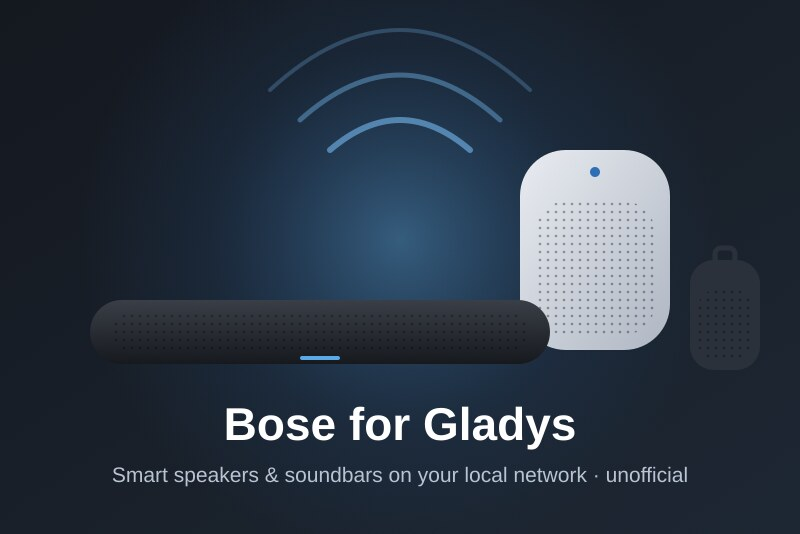
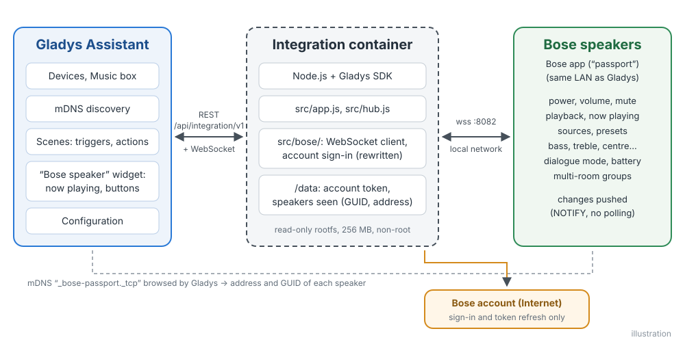
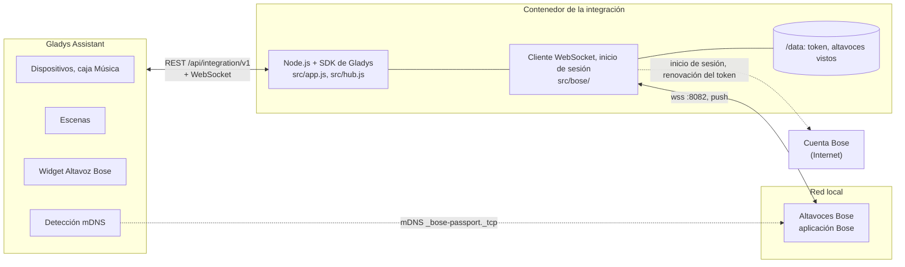
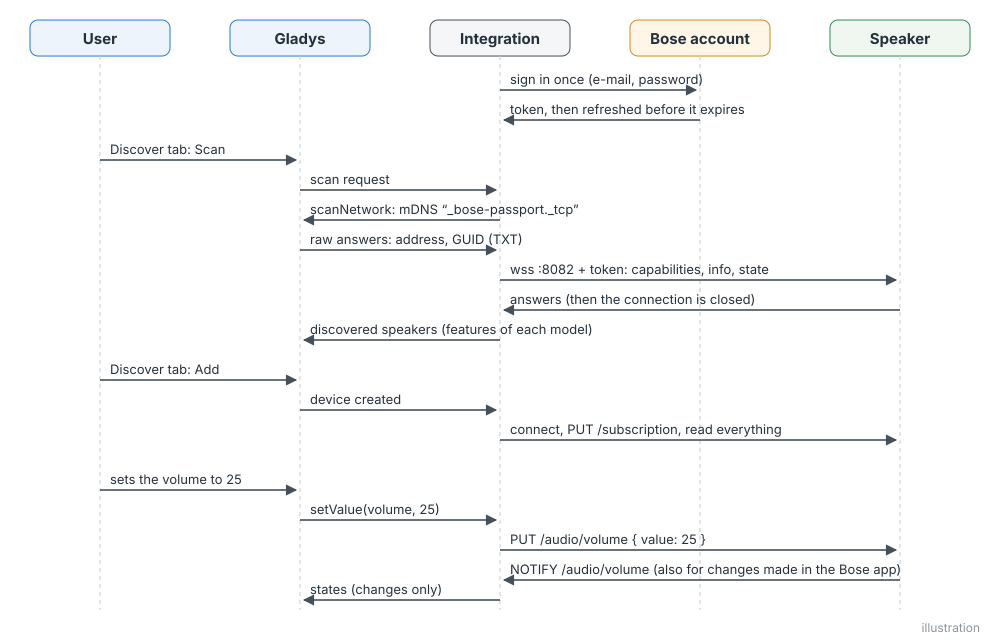
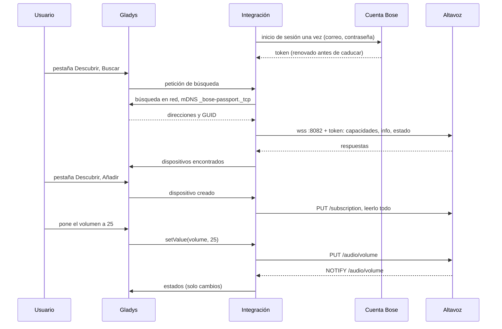
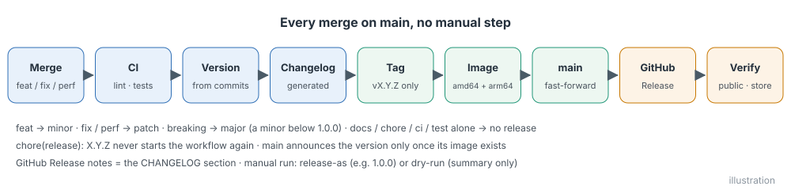

# Bose para Gladys Assistant

[English](README.md) | [Français](README.fr.md) | [Deutsch](README.de.md) | **Español**

[](LICENSE)
[](https://github.com/William-De71/gladys-bose/releases)
[](https://github.com/William-De71/gladys-bose/actions/workflows/release.yml)
[](https://gladysassistant.com)



Sus altavoces y barras de sonido Bose recientes (los configurados con la aplicación Bose) en Gladys Assistant, controlados en su red local y con sus cambios notificados en tiempo real. Encendido, volumen, reproducción, fuentes y presintonías, ajustes de sonido, modo diálogo, batería, grupos multisala, un widget de panel y escenas. No oficial, sin relación con Bose.

## Funciones

- **Detección** mediante la búsqueda mDNS de Gladys (`_bose-passport._tcp`); se pueden escribir direcciones IP para los altavoces que no alcanza. Cada altavoz se identifica por su GUID y se vuelve a encontrar tras un cambio de dirección.
- **Un dispositivo por altavoz**: Encendido, Volumen, Silencio, Reproducir, Pausa, Anterior, Siguiente, Estado de reproducción (la caja Música del panel), Fuente (TV, óptica, analógica, AUX, presintonías), Reproduciendo, Artista, el reproductor de música de Gladys 5.3 (Título, Artista de la pista, Álbum, Carátula, Duración, Posición, Silencio) con las presintonías en su panel de exploración y, según el modelo, Graves, Medios, Agudos, Central, Envolvente, Altura, Subwoofer, Modo diálogo, Batería y Cargando.
- **Estados notificados**: los altavoces avisan de cada cambio por su WebSocket local; no se consulta nada en bucle (una comprobación de presencia por minuto).
- **Un widget de panel**: lo que suena con la carátula, estado, fuente, volumen, batería, grupo y los botones Anterior, Reproducir/Pausa, Siguiente, En espera.
- **Cuatro disparadores de escena** (reproducción iniciada, reproducción detenida, fuente cambiada, altavoz inaccesible) y **tres acciones de escena** (reproducir una presintonía, agrupar altavoces, sacar un altavoz de su grupo).
- **Inicio de sesión en la cuenta Bose** y renovación del token a cargo de la integración (los altavoces lo exigen), contraseña guardada como secreto de Gladys, nunca registrada.
- Inglés, francés, alemán y español.

**¿Qué integración Bose?** Esta es para los altavoces de la **aplicación Bose** (antes Bose Music): Smart Soundbar, Smart Ultra Soundbar, Soundbar 550/700/900, Smart Speaker, Home Speaker 300/500, Portable Smart Speaker, Music Amplifier. La antigua gama **SoundTouch** (SoundTouch 10/20/30/300, Wave SoundTouch, configurados con la aplicación SoundTouch, API local en el puerto 8090) la cubre [Bose SoundTouch](https://github.com/guim31/gladys-soundtouch) de guim31.

## Funcionamiento





Gladys, en la red del anfitrión, explora el servicio mDNS de los altavoces y retransmite las respuestas (dirección y GUID): el contenedor está detrás del puente Docker, donde el multicast nunca llega a la red. La integración abre después el WebSocket local de cada altavoz (`wss://<dirección>:8082`, subprotocolo `eco2`, certificado autofirmado), lee sus capacidades y su estado, y se suscribe a sus cambios. Cada petición lleva el token de la cuenta Bose a la que pertenece el altavoz: Bose hace que rechacen todo lo demás. Ese token se obtiene una vez de la nube de Bose (las páginas de inicio de sesión de la aplicación Bose y luego el servicio de tokens de Bose) y se renueva antes de caducar; ninguna orden ni ningún estado pasa por la nube.





### Dispositivos y funciones

| Función                                                        | Categoría / tipo                                | Valores                                                                                |
| -------------------------------------------------------------- | ----------------------------------------------- | -------------------------------------------------------------------------------------- |
| Encendido, Silencio                                            | `switch` / `binary`                             | 0 / 1                                                                                  |
| Volumen                                                        | `music` / `volume`                              | 0 a 100                                                                                |
| Reproducir, Pausa, Anterior, Siguiente                         | `music` / `play`, `pause`, `previous`, `next`   | botones                                                                                |
| Estado de reproducción                                         | `music` / `playback_state`                      | 1 reproduciendo, 0 si no; modificable: 1 reproduce, 0 pausa (sin parada)               |
| Fuente                                                         | `text` / `select`                               | `other`, `tv`, `optical`, `analog`, `aux`, `preset-1`…                                 |
| Reproduciendo, Artista                                         | `text` / `text`                                 | texto                                                                                  |
| Título, Artista de la pista, Álbum, Carátula                   | `music` / `title`, `artist`, `album`, `artwork` | texto, vacío cuando no suena nada; la carátula es una clave servida por la integración |
| Duración, Posición                                             | `music` / `duration`, `position` (segundos)     | posición tomada en cada aviso del altavoz; escribirla salta a ella                     |
| Silencio (reproductor)                                         | `music` / `mute`                                | 0 / 1                                                                                  |
| Graves, Medios, Agudos, Central, Envolvente, Altura, Subwoofer | `text` / `select`                               | valores brutos del altavoz (−100…+100, paso 10)                                        |
| Modo diálogo                                                   | `text` / `select`                               | modos de la barra de sonido (`NORMAL`, `DIALOG`…)                                      |
| Batería, Cargando                                              | `battery` / `integer` (%), `charging`           | altavoces portátiles                                                                   |

Identificador externo del dispositivo: `ext:<selector>:speaker:<GUID>`; funciones `…:power`, `…:volume`, `…:mute`, `…:play`, `…:pause`, `…:previous`, `…:next`, `…:playback-state`, `…:source`, `…:title`, `…:artist`, `…:music-title`, `…:music-artist`, `…:album`, `…:artwork`, `…:duration`, `…:position`, `…:music-mute`, `…:bass`, `…:midrange`, `…:treble`, `…:center`, `…:surround`, `…:height`, `…:subwoofer`, `…:audio-mode`, `…:battery`, `…:charging`. Solo se declaran las funciones que tiene el altavoz (los altavoces no siempre listan sus ajustes de sonido: los que faltan se piden igualmente, con una espera corta).

**Caja Música (Gladys 5.3)**: la caja muestra la carátula, el título, el artista, el álbum y una barra de progreso, con reproducir/pausa, anterior, siguiente, salto en la pista, volumen y silencio. Su panel de exploración lista las presintonías del altavoz: un toque inicia una. No hay búsqueda ni cola (la API local de los altavoces no las tiene), y la carátula solo se muestra cuando el servicio de música da una dirección https. Un altavoz añadido con una versión anterior recibe las nuevas funciones con el botón **Actualizar** de la pestaña Descubrir; las funciones existentes, sus identificadores externos y las escenas que las usan no cambian.

## Transporte

`transports: ["local"]`: las órdenes y los estados solo circulan por su red local. La nube de Bose se contacta para una sola cosa, el token de cuenta que exigen los altavoces: un inicio de sesión con el correo y la contraseña y luego una renovación como mucho una vez por hora. Es un paso de autenticación, no un canal: no permite controlar nada, así que la integración no declara transporte `cloud` y Gladys no muestra el botón «Preferir la conexión local». Cada altavoz muestra una insignia **local**, o **inaccesible** cuando no responde.

## Widgets


- **Altavoz Bose**: un altavoz elegido en los ajustes: lo que suena y su carátula (cuando el servicio de música proporciona una de menos de 300 KB), estado, fuente, volumen, batería, grupo y los botones **Anterior**, **Reproducir** / **Pausa**, **Siguiente**, **En espera** (**Encender** en espera).

Las imágenes las genera `docs/illustrations/render.sh` a partir del código real del widget: son ilustraciones, no capturas de pantalla (la carátula está dibujada para la ilustración).

## Disparadores y acciones de escena

| Disparador            | Filtros               | Variables                                                 |
| --------------------- | --------------------- | --------------------------------------------------------- |
| `playback_started`    | altavoz               | `device_name`, `title`, `artist`, `source`                |
| `playback_stopped`    | altavoz               | `device_name`, `title`, `artist`, `source`                |
| `source_changed`      | altavoz, nueva fuente | `device_name`, `source`, `source_name`, `previous_source` |
| `speaker_unreachable` | altavoz               | `device_name`, `address`                                  |

| Acción            | Campos                                  | Salidas       |
| ----------------- | --------------------------------------- | ------------- |
| `play_preset`     | altavoz, presintonía 1 a 6              | `preset_name` |
| `group_speakers`  | altavoz principal, altavoces que añadir | `group_size`  |
| `ungroup_speaker` | altavoz                                 | ninguna       |

Un evento por transición notificada por el altavoz; ninguno en los cinco segundos siguientes a una acción de escena sobre él. Ejemplos:

- Cada día laborable a las 7 h → **Reproducir una presintonía en un altavoz Bose** (cocina, presintonía 1) y poner el volumen a 25.
- **Un altavoz Bose cambia de fuente** a `tv` → bajar las luces del salón y cerrar las persianas.
- **Un altavoz Bose deja de responder** → enviar una notificación.

## Requisitos

- Gladys Assistant **5.3.0 o posterior** (reproductores de música y palabras clave del catálogo de integraciones, widgets de panel y disparadores y acciones de escena; las instancias anteriores no pueden instalar la integración).
- Altavoces configurados en la **aplicación Bose**, en la misma red que Gladys y pertenecientes a la cuenta Bose introducida.
- El correo y la contraseña de esa cuenta Bose (las cuentas abiertas con Google o Apple deben definir antes una contraseña) y acceso a Internet para el inicio de sesión.

## Instalación

- **Desde la tienda**: Integraciones → buscar «Bose» → Instalar. Acepte la detección de red (mDNS) en la pantalla de instalación.
- **Desde la URL del repositorio**: Integraciones → Instalar una integración → pegar `https://github.com/William-De71/gladys-bose`.
- **Modo desarrollador**: Integraciones → Instalar una integración → Modo desarrollador, con el manifiesto de una compilación (el resumen del workflow «Build and publish image» lo muestra).

## Configuración

| Campo             | Tipo   | Por defecto | Significado                                                                           |
| ----------------- | ------ | ----------- | ------------------------------------------------------------------------------------- |
| `email`           | string | —           | correo de la cuenta Bose a la que pertenecen los altavoces (obligatorio)              |
| `password`        | secret | —           | su contraseña (obligatoria), nunca se vuelve a mostrar ni se registra                 |
| `hosts`           | string | vacío       | direcciones IP de los altavoces que la búsqueda no encuentra, separadas por comas     |
| `rescan_interval` | select | `60`        | búsqueda automática en minutos: `0` (desactivada), `15`, `60`                         |
| `language`        | select | `en`        | idioma de los nombres de funciones, fuentes y presintonías y de los errores de escena |

Botón de la página de configuración: **Probar la cuenta y buscar los altavoces** (inicia sesión si hace falta, busca en la red y lista cada altavoz con su modelo, su dirección y si responde).

## Uso

1. Instale la integración, introduzca el correo y la contraseña de su cuenta Bose, guarde y pulse **Probar la cuenta y buscar los altavoces**.
2. Añada los altavoces desde la pestaña **Descubrir**.
3. Añada la caja Música o el widget «Altavoz Bose» a un panel y cree sus escenas.

La documentación de usuario está en [docs/es.md](docs/es.md) ([en](docs/en.md), [fr](docs/fr.md), [de](docs/de.md)).

## Límites

- El protocolo local y el inicio de sesión proceden de **ingeniería inversa** (no hay API pública de Bose): se reescribieron en JavaScript para este proyecto a partir de las notas de [pybose](https://github.com/cavefire/pybose) y de la [integración Bose para Home Assistant](https://github.com/cavefire/Bose-Homeassistant) (GPL-3.0, leídas como documentación, sin copiar código). Una actualización de Bose puede romperlos.
- **Nunca probada con un altavoz real ni con una cuenta Bose real**: todo se prueba con altavoces simulados (WebSockets locales reales) y un inicio de sesión Bose simulado que siguen el protocolo documentado. Se agradecen los comentarios.
- El inicio de sesión sigue las páginas web de la aplicación Bose: una cuenta con verificación en dos pasos o captcha no puede iniciar sesión.
- Sin cambio a una fuente Bluetooth, sin reproducción Chromecast ni de URL, sin ajustes de Alexa / Asistente de Google, sin ajustes de accesorios (módulo de graves, altavoces traseros).
- Los ajustes de sonido aparecen como valores brutos en una lista (Gladys no tiene una categoría de control deslizante genérica para ellos).
- La carátula no se redimensiona: por encima de 300 KB no se muestra.

## Desarrollo local

```bash
npm install
GLADYS_HOST_API_URL=http://localhost:1443 \
  GLADYS_INTEGRATION_TOKEN=… GLADYS_INTEGRATION_SELECTOR=… \
  BOSE_DATA_DIR=./data DEBUG=gladys-integration-sdk node index.js
```

| Variable                                                                         | Por defecto       | Uso                                                 |
| -------------------------------------------------------------------------------- | ----------------- | --------------------------------------------------- |
| `GLADYS_HOST_API_URL`, `GLADYS_INTEGRATION_TOKEN`, `GLADYS_INTEGRATION_SELECTOR` | fijado por Gladys | conexión con la API anfitriona de Gladys            |
| `BOSE_DATA_DIR`                                                                  | `/data`           | carpeta de `account.json` y `speakers.json`         |
| `DEBUG`                                                                          | sin definir       | `gladys-integration-sdk` para los registros del SDK |

| Script                            | Qué hace                                     |
| --------------------------------- | -------------------------------------------- |
| `npm test`                        | las pruebas (`node --test`), sin red         |
| `npm run lint`                    | ESLint                                       |
| `npm run format` / `format:check` | Prettier                                     |
| `docs/illustrations/render.sh`    | regenera las ilustraciones del widget        |
| `scripts/build-cover.sh`          | regenera `cover.jpg` a partir de `cover.svg` |

## Pruebas

`npm test` ejecuta toda la integración contra el Gladys simulado del SDK, una nube Bose simulada (las páginas de inicio de sesión B2C con control de cookies, del token antifalsificación, de la transacción y del PKCE, y luego el intercambio de tokens) y altavoces simulados sobre WebSockets locales reales que comprueban cada petición (GUID, token, número de petición), callan ante los recursos desconocidos, rechazan un token «aún no válido» para su reloj y envían notificaciones tras la suscripción. Cubierto: detección por mDNS y por dirección, inicio de sesión, almacenamiento y renovación del token, contraseñas rechazadas, estados notificados, cada orden, disparadores y acciones de escena, grupos, el widget validado por `validateWidgetContent` y su carátula por `validateWidgetImage`, altavoces perdidos, cambios de dirección, reinicios, registros sin secretos y la conexión TLS con certificado autofirmado. El dispositivo se comprueba contra las reglas del núcleo de Gladys y una referencia de detección (los identificadores externos son para siempre), el manifiesto contra el código, las traducciones y el script de publicación. La CI también construye la imagen y la arranca como Gladys (solo lectura, 256 MB, sin red).

## Proceso de publicación

Cada fusión en `main` publica una versión cuando sus commits lo justifican, sin ningún paso manual:

```mermaid
flowchart LR
  A[fusión en main] --> B[CI: Prettier, ESLint,<br/>pruebas, build Docker]
  B --> C[siguiente versión según<br/>los Conventional Commits]
  C --> D[sección de CHANGELOG.md]
  D --> E[commit chore release<br/>+ etiqueta vX.Y.Z]
  E --> F[imagen :X.Y.Z + :latest<br/>amd64 + arm64]
  F --> G[main avanza hasta el<br/>commit de publicación]
  G --> H[GitHub Release]
  H --> I[verificación: pull anónimo,<br/>validador de la tienda, topic]
```





- `feat` → menor, `fix` / `perf` → parche, `!` o `BREAKING CHANGE:` → mayor (una menor antes de 1.0.0). `docs`, `chore`, `ci`, `test`, `style`, `refactor`, `build` solos no publican nada.
- El título de la pull request se convierte en el commit squash y, por tanto, en la línea del changelog: escríbalo en inglés, para el usuario (`feat(widget): …`). `pr-title.yml` lo comprueba. No edite nunca `CHANGELOG.md` a mano.
- La imagen existe antes de que `main` anuncie su versión (la tienda indexa `main`).
- La 1.0.0 es una decisión manual: Actions → Release → Run workflow, `release-as: 1.0.0`. `dry-run` muestra la versión y el changelog sin publicar.
- **`main` protegida**: la publicación empuja un commit a `main`. Con una protección de rama o un ruleset que exija pull requests o status checks, permita que GitHub Actions lo omita (o use una GitHub App); si no, la publicación se detiene tras la imagen.
- Tras la primera publicación, haga público el paquete si hace falta: Package settings → Change visibility → Public.

## Solución de problemas

- **«Bose rechazó el correo o la contraseña»**: compruébelos en la aplicación Bose; una cuenta abierta con Google o Apple necesita primero una contraseña. No hay nuevo intento hasta que cambie la configuración.
- **No se encuentra ningún altavoz**: compruebe que está configurado en la aplicación Bose (no SoundTouch) y en la misma red que Gladys, o escriba su dirección.
- **Un altavoz rechaza el token**: debe pertenecer a la cuenta Bose introducida.
- **«Gladys rechazó la búsqueda en la red»**: reinstale la integración aceptando su detección de red en la pantalla de instalación.
- Registros: la pestaña Registros de la integración; `DEBUG=gladys-integration-sdk` para el detalle del SDK.

## Contribuir

Las incidencias y pull requests son bienvenidas. Ejecute `npm run format:check`, `npm run lint` y `npm test`, escriba el título de la pull request como Conventional Commit y ejecute `docs/illustrations/render.sh` tras cualquier cambio en el contenido del widget. Una nueva función no debe cambiar las existentes (`test/fixtures/discovery.baseline.json`). No pegue nunca código de proyectos GPL (pybose, la integración de Home Assistant): describa el protocolo y reescríbalo.

## Seguridad

Consulte [SECURITY.md](SECURITY.md). La contraseña es un secreto de Gladys, se envía solo a la página de inicio de sesión de Bose y nunca se registra. `/data/account.json` (legible solo por el usuario del contenedor) contiene los tokens de Bose y una huella del correo; `/data/speakers.json` el GUID, la dirección, el nombre y el modelo de cada altavoz visto. El certificado autofirmado de los altavoces se acepta en la red local (no tienen otro).

## Licencia

[Licencia Apache 2.0](LICENSE), véase también [NOTICE](NOTICE). El protocolo se implementa para este proyecto a partir de las descripciones de pybose y de la integración Bose para Home Assistant (GPL-3.0); no se copia código. Bose es una marca de Bose Corporation; este proyecto no está afiliado, respaldado ni apoyado por Bose.
