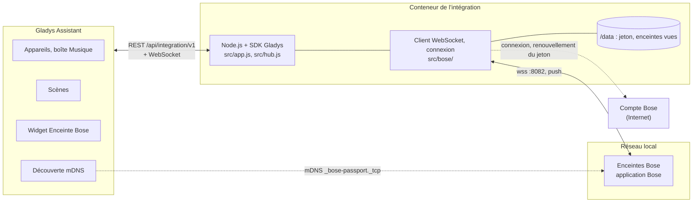
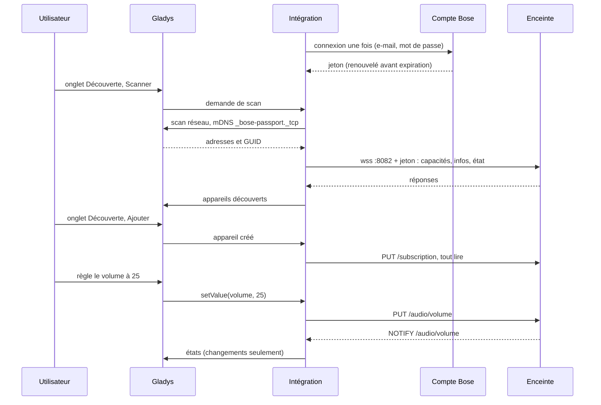

# Bose pour Gladys Assistant

[English](README.md) | **Français** | [Deutsch](README.de.md) | [Español](README.es.md)

[](LICENSE)
[](https://github.com/William-De71/gladys-bose/releases)
[](https://github.com/William-De71/gladys-bose/actions/workflows/release.yml)
[](https://gladysassistant.com)


Vos enceintes et barres de son Bose récentes (celles installées avec l’application Bose) dans Gladys Assistant, pilotées sur votre réseau local avec leurs changements remontés en temps réel. Marche, volume, lecture, sources et préréglages, réglages du son, mode dialogue, batterie, groupes multiroom, un widget de tableau de bord et des scènes. Non officielle, sans lien avec Bose.

## Fonctionnalités

- **Découverte** par la recherche mDNS de Gladys (`_bose-passport._tcp`) ; des adresses IP peuvent être saisies pour les enceintes qu’elle n’atteint pas. Chaque enceinte est identifiée par son GUID et retrouvée après un changement d’adresse.
- **Un appareil par enceinte** : Marche/veille, Volume, Muet, Lecture, Pause, Précédent, Suivant, État de la lecture (la boîte Musique du tableau de bord), Source (TV, optique, analogique, AUX, préréglages), En cours, Artiste, et selon le modèle Graves, Médiums, Aigus, Centre, Surround, Hauteur, Caisson de basses, Mode dialogue, Batterie et En charge.
- **États poussés** : les enceintes signalent chaque changement sur leur WebSocket local ; rien n’est interrogé en boucle (un contrôle de présence par minute).
- **Un widget de tableau de bord** : la lecture en cours avec la pochette, état, source, volume, batterie, groupe, et les boutons Précédent, Lecture/Pause, Suivant, Veille.
- **Quatre déclencheurs de scène** (lecture démarrée, lecture arrêtée, source changée, enceinte injoignable) et **trois actions de scène** (lancer un préréglage, grouper des enceintes, sortir une enceinte de son groupe).
- **Connexion au compte Bose** et renouvellement du jeton gérés par l’intégration (les enceintes l’exigent), mot de passe stocké comme secret Gladys, jamais journalisé.
- Anglais, français, allemand et espagnol.

**Quelle intégration Bose ?** Celle-ci est pour les enceintes de l’**application Bose** (anciennement Bose Music) : Smart Soundbar, Smart Ultra Soundbar, Soundbar 550/700/900, Smart Speaker, Home Speaker 300/500, Portable Smart Speaker, Music Amplifier. L’ancienne gamme **SoundTouch** (SoundTouch 10/20/30/300, Wave SoundTouch, installées avec l’application SoundTouch, API locale sur le port 8090) est gérée par [Bose SoundTouch](https://github.com/guim31/gladys-soundtouch) de guim31.

## Fonctionnement




Gladys, sur le réseau de l’hôte, parcourt le service mDNS des enceintes et relaie les réponses (adresse et GUID) : le conteneur est derrière le pont Docker, où le multicast n’atteint jamais le réseau. L’intégration ouvre ensuite le WebSocket local de chaque enceinte (`wss://<adresse>:8082`, sous-protocole `eco2`, certificat auto-signé), lit ses capacités et son état, et s’abonne à ses changements. Chaque requête porte le jeton du compte Bose auquel l’enceinte appartient : Bose fait refuser tout le reste. Ce jeton est obtenu une fois auprès du cloud Bose (les pages de connexion de l’application Bose, puis le service de jetons Bose) et renouvelé avant son expiration ; aucune commande ni aucun état ne passe par le cloud.




### Appareils et fonctionnalités

| Fonctionnalité                                             | Catégorie / type                              | Valeurs                                                |
| ---------------------------------------------------------- | --------------------------------------------- | ------------------------------------------------------ |
| Marche/veille, Muet                                        | `switch` / `binary`                           | 0 / 1                                                  |
| Volume                                                     | `music` / `volume`                            | 0 à 100                                                |
| Lecture, Pause, Précédent, Suivant                         | `music` / `play`, `pause`, `previous`, `next` | boutons                                                |
| État de la lecture                                         | `music` / `playback_state`                    | 1 en lecture, 0 sinon                                  |
| Source                                                     | `text` / `select`                             | `other`, `tv`, `optical`, `analog`, `aux`, `preset-1`… |
| En cours, Artiste                                          | `text` / `text`                               | texte                                                  |
| Graves, Médiums, Aigus, Centre, Surround, Hauteur, Caisson | `text` / `select`                             | valeurs brutes de l’enceinte (−100…+100, pas de 10)    |
| Mode dialogue                                              | `text` / `select`                             | modes de la barre de son (`NORMAL`, `DIALOG`…)         |
| Batterie, En charge                                        | `battery` / `integer` (%), `charging`         | enceintes portables                                    |

Identifiant externe de l’appareil : `ext:<sélecteur>:speaker:<GUID>` ; fonctionnalités `…:power`, `…:volume`, `…:mute`, `…:play`, `…:pause`, `…:previous`, `…:next`, `…:playback-state`, `…:source`, `…:title`, `…:artist`, `…:bass`, `…:midrange`, `…:treble`, `…:center`, `…:surround`, `…:height`, `…:subwoofer`, `…:audio-mode`, `…:battery`, `…:charging`. Seules les fonctionnalités que l’enceinte possède sont déclarées (les enceintes ne listent pas toujours leurs réglages du son : ceux qui manquent sont quand même demandés, avec un délai court).

## Transport

`transports: ["local"]` : commandes et états ne circulent que sur votre réseau local. Le cloud Bose n’est contacté que pour une chose, le jeton de compte exigé par les enceintes : une connexion avec l’e-mail et le mot de passe, puis un renouvellement au plus une fois par heure. C’est une étape d’authentification, pas un canal : rien ne peut être piloté par là, donc l’intégration ne déclare pas de transport `cloud` et Gladys n’affiche pas de bouton « Préférer la connexion locale ». Chaque enceinte affiche un badge **local**, ou **injoignable** quand elle ne répond pas.

## Widgets


- **Enceinte Bose** : une enceinte choisie dans les réglages : la lecture en cours et sa pochette (quand le service de musique en fournit une de moins de 300 Ko), état, source, volume, batterie, groupe, et les boutons **Précédent**, **Lecture** / **Pause**, **Suivant**, **Veille** (**Allumer** en veille).

Les images sont générées par `docs/illustrations/render.sh` à partir du vrai code du widget : ce sont des illustrations, pas des captures d’écran (la pochette est dessinée pour l’illustration).

## Déclencheurs et actions de scène

| Déclencheur           | Filtres                   | Variables                                                 |
| --------------------- | ------------------------- | --------------------------------------------------------- |
| `playback_started`    | enceinte                  | `device_name`, `title`, `artist`, `source`                |
| `playback_stopped`    | enceinte                  | `device_name`, `title`, `artist`, `source`                |
| `source_changed`      | enceinte, nouvelle source | `device_name`, `source`, `source_name`, `previous_source` |
| `speaker_unreachable` | enceinte                  | `device_name`, `address`                                  |

| Action            | Champs                                   | Sorties       |
| ----------------- | ---------------------------------------- | ------------- |
| `play_preset`     | enceinte, préréglage 1 à 6               | `preset_name` |
| `group_speakers`  | enceinte principale, enceintes à ajouter | `group_size`  |
| `ungroup_speaker` | enceinte                                 | aucune        |

Un événement par transition signalée par l’enceinte ; aucun dans les cinq secondes qui suivent une action de scène sur elle. Exemples :

- Chaque jour de semaine à 7 h → **Lancer un préréglage sur une enceinte Bose** (cuisine, préréglage 1), puis régler son volume à 25.
- **Une enceinte Bose change de source** vers `tv` → baisser les lumières du salon et fermer les volets.
- **Une enceinte Bose ne répond plus** → envoyer une notification.

## Prérequis

- Gladys Assistant **5.1.0 ou plus récent** (widgets de tableau de bord et déclencheurs et actions de scène des intégrations ; les instances plus anciennes ne peuvent pas installer l’intégration).
- Des enceintes installées dans l’**application Bose**, sur le même réseau que Gladys, appartenant au compte Bose saisi.
- L’e-mail et le mot de passe de ce compte Bose (un compte ouvert avec Google ou Apple doit d’abord définir un mot de passe), et un accès Internet pour la connexion.

## Installation

- **Depuis le store** : Intégrations → chercher « Bose » → Installer. Acceptez la découverte réseau (mDNS) à l’installation.
- **Depuis l’URL du dépôt** : Intégrations → Installer une intégration → coller `https://github.com/William-De71/gladys-bose`.
- **Mode développeur** : Intégrations → Installer une intégration → Mode développeur, avec le manifeste d’un build (le résumé du workflow « Build and publish image » l’affiche).

## Configuration

| Champ             | Type   | Défaut | Rôle                                                                                |
| ----------------- | ------ | ------ | ----------------------------------------------------------------------------------- |
| `email`           | string | —      | e-mail du compte Bose auquel appartiennent les enceintes (obligatoire)              |
| `password`        | secret | —      | son mot de passe (obligatoire), jamais réaffiché ni journalisé                      |
| `hosts`           | string | vide   | adresses IP des enceintes que la recherche ne trouve pas, séparées par des virgules |
| `rescan_interval` | select | `60`   | recherche automatique en minutes : `0` (désactivée), `15`, `60`                     |
| `language`        | select | `en`   | langue des noms de fonctionnalités, sources, préréglages et des erreurs de scène    |

Bouton de la page de configuration : **Tester le compte et rechercher les enceintes** (se connecte si besoin, cherche sur le réseau et liste chaque enceinte avec son modèle, son adresse et si elle répond).

## Utilisation

1. Installez l’intégration, saisissez l’e-mail et le mot de passe de votre compte Bose, enregistrez, puis appuyez sur **Tester le compte et rechercher les enceintes**.
2. Ajoutez les enceintes depuis l’onglet **Découverte**.
3. Ajoutez la boîte Musique ou le widget « Enceinte Bose » à un tableau de bord, créez vos scènes.

La documentation utilisateur est dans [docs/fr.md](docs/fr.md) ([en](docs/en.md), [de](docs/de.md), [es](docs/es.md)).

## Limites

- Le protocole local et la connexion sont issus de **rétro-ingénierie** (aucune API Bose publique) : ils ont été réécrits en JavaScript pour ce projet d’après les notes de [pybose](https://github.com/cavefire/pybose) et de l’[intégration Bose pour Home Assistant](https://github.com/cavefire/Bose-Homeassistant) (GPL-3.0, lues comme documentation, aucun code copié). Une mise à jour Bose peut les casser.
- **Jamais testée sur une vraie enceinte ni avec un vrai compte Bose** : tout est testé contre des enceintes simulées (vrais WebSockets locaux) et une connexion Bose simulée qui suivent le protocole documenté. Retours bienvenus.
- La connexion suit les pages web de l’application Bose : un compte avec double authentification ou captcha ne peut pas se connecter.
- Pas de bascule vers une source Bluetooth, pas de lecture Chromecast ni d’URL, pas de réglages Alexa / Assistant Google, pas de réglage des accessoires (module de basses, enceintes arrière).
- Les réglages du son sont présentés en valeurs brutes dans une liste (Gladys n’a pas de catégorie de curseur générique pour eux).
- La pochette n’est pas redimensionnée : au-delà de 300 Ko, elle n’est pas affichée.

## Développement local

```bash
npm install
GLADYS_HOST_API_URL=http://localhost:1443 \
  GLADYS_INTEGRATION_TOKEN=… GLADYS_INTEGRATION_SELECTOR=… \
  BOSE_DATA_DIR=./data DEBUG=gladys-integration-sdk node index.js
```

| Variable                                                                         | Défaut          | Usage                                             |
| -------------------------------------------------------------------------------- | --------------- | ------------------------------------------------- |
| `GLADYS_HOST_API_URL`, `GLADYS_INTEGRATION_TOKEN`, `GLADYS_INTEGRATION_SELECTOR` | fixé par Gladys | connexion à l’API hôte de Gladys                  |
| `BOSE_DATA_DIR`                                                                  | `/data`         | dossier de `account.json` et `speakers.json`      |
| `DEBUG`                                                                          | non défini      | `gladys-integration-sdk` pour les journaux du SDK |

| Script                            | Rôle                                    |
| --------------------------------- | --------------------------------------- |
| `npm test`                        | les tests (`node --test`), sans réseau  |
| `npm run lint`                    | ESLint                                  |
| `npm run format` / `format:check` | Prettier                                |
| `docs/illustrations/render.sh`    | regénère les illustrations du widget    |
| `scripts/build-cover.sh`          | regénère `cover.jpg` depuis `cover.svg` |

## Tests

`npm test` fait tourner toute l’intégration contre le faux Gladys du SDK, un faux cloud Bose (les pages de connexion B2C avec contrôle des cookies, du jeton anti-falsification, de la transaction et du PKCE, puis l’échange de jetons) et de fausses enceintes sur de vrais WebSockets locaux qui vérifient chaque requête (GUID, jeton, numéro de requête), se taisent sur les ressources inconnues, refusent un jeton « pas encore valide » pour leur horloge et envoient des notifications après l’abonnement. Couverts : découverte par mDNS et par adresse, connexion, stockage et renouvellement du jeton, mots de passe refusés, états poussés, chaque commande, déclencheurs et actions de scène, groupes, le widget validé par `validateWidgetContent` et sa pochette par `validateWidgetImage`, enceintes perdues, changements d’adresse, redémarrages, journaux sans secret, et la connexion TLS avec certificat auto-signé. L’appareil est vérifié contre les règles du cœur de Gladys et une référence de découverte (les identifiants externes sont éternels), le manifeste contre le code, les traductions et le script de release. La CI construit aussi l’image et la lance comme Gladys (lecture seule, 256 Mo, sans réseau).

## Processus de release

Chaque fusion sur `main` publie une release quand ses commits le justifient, sans étape manuelle :

```mermaid
flowchart LR
  A[fusion sur main] --> B[CI : Prettier, ESLint,<br/>tests, build Docker]
  B --> C[version suivante d’après<br/>les Conventional Commits]
  C --> D[section du CHANGELOG.md]
  D --> E[commit chore release<br/>+ tag vX.Y.Z]
  E --> F[image :X.Y.Z + :latest<br/>amd64 + arm64]
  F --> G[main avance jusqu’au<br/>commit de release]
  G --> H[GitHub Release]
  H --> I[vérification : pull anonyme,<br/>validateur du store, topic]
```




- `feat` → mineure, `fix` / `perf` → correctif, `!` ou `BREAKING CHANGE:` → majeure (une mineure avant 1.0.0). `docs`, `chore`, `ci`, `test`, `style`, `refactor`, `build` seuls ne publient rien.
- Le titre de la pull request devient le commit squash, donc la ligne du changelog : écrivez-le en anglais, pour l’utilisateur (`feat(widget): …`). `pr-title.yml` le vérifie. N’éditez jamais `CHANGELOG.md` à la main.
- L’image existe avant que `main` annonce sa version (le store indexe `main`).
- La 1.0.0 est une décision manuelle : Actions → Release → Run workflow, `release-as: 1.0.0`. `dry-run` affiche la version et le changelog sans rien publier.
- **`main` protégée** : la release pousse un commit sur `main`. Avec une protection de branche ou un ruleset exigeant des pull requests ou des status checks, autorisez GitHub Actions à le contourner (ou utilisez une GitHub App), sinon la release s’arrête après l’image.
- Après la première release, rendez le package public si besoin : Package settings → Change visibility → Public.

## Dépannage

- **« Bose a refusé l’e-mail ou le mot de passe »** : vérifiez-les dans l’application Bose ; un compte ouvert avec Google ou Apple a d’abord besoin d’un mot de passe. Aucune nouvelle tentative tant que la configuration ne change pas.
- **Aucune enceinte trouvée** : vérifiez qu’elle est installée dans l’application Bose (pas SoundTouch) et sur le même réseau que Gladys, ou saisissez son adresse.
- **Une enceinte refuse le jeton** : elle doit appartenir au compte Bose saisi.
- **« Gladys a refusé la recherche réseau »** : réinstallez l’intégration en acceptant sa découverte réseau à l’installation.
- Journaux : l’onglet Journaux de l’intégration ; `DEBUG=gladys-integration-sdk` pour le détail du SDK.

## Contribuer

Tickets et pull requests bienvenus. Lancez `npm run format:check`, `npm run lint` et `npm test`, écrivez le titre de la pull request en Conventional Commit, et relancez `docs/illustrations/render.sh` après toute modification du contenu du widget. Une nouvelle fonctionnalité ne doit pas modifier les existantes (`test/fixtures/discovery.baseline.json`). Ne collez jamais de code de projets GPL (pybose, l’intégration Home Assistant) : décrivez le protocole, réécrivez-le.

## Sécurité

Voir [SECURITY.md](SECURITY.md). Le mot de passe est un secret Gladys, envoyé uniquement à la page de connexion Bose, jamais journalisé. `/data/account.json` (lisible par le seul utilisateur du conteneur) contient les jetons Bose et une empreinte de l’e-mail ; `/data/speakers.json` le GUID, l’adresse, le nom et le modèle de chaque enceinte vue. Le certificat auto-signé des enceintes est accepté sur le réseau local (elles n’en ont pas d’autre).

## Licence

[Licence Apache 2.0](LICENSE), voir aussi [NOTICE](NOTICE). Le protocole est implémenté pour ce projet d’après les descriptions de pybose et de l’intégration Bose pour Home Assistant (GPL-3.0) ; aucun code n’est copié. Bose est une marque de Bose Corporation ; ce projet n’est ni affilié, ni approuvé, ni soutenu par Bose.
