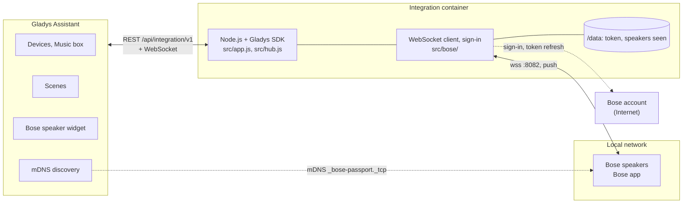
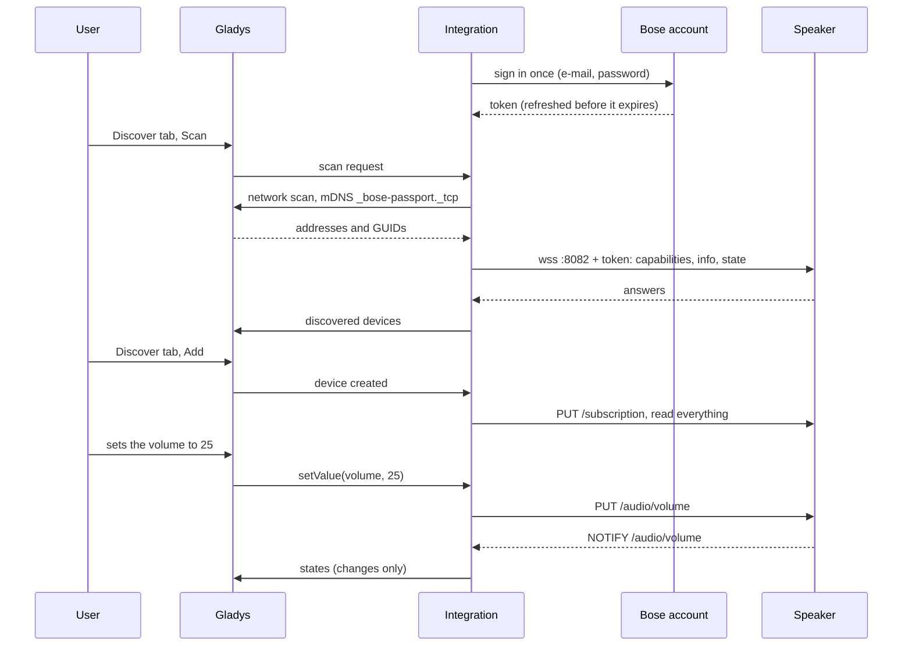

# Bose for Gladys Assistant

**English** | [Français](README.fr.md) | [Deutsch](README.de.md) | [Español](README.es.md)

[](LICENSE)
[](https://github.com/William-De71/gladys-bose/releases)
[](https://github.com/William-De71/gladys-bose/actions/workflows/release.yml)
[](https://gladysassistant.com)


Your recent Bose smart speakers and soundbars (the ones set up with the Bose app) in Gladys Assistant, controlled on your local network with their changes pushed in real time. Power, volume, playback, sources and presets, sound settings, dialogue mode, battery, multi-room groups, a dashboard widget and scenes. Unofficial, not affiliated with Bose.

## Features

- **Discovery** through the mDNS search of Gladys (`_bose-passport._tcp`); IP addresses can be typed for the speakers it cannot reach. Each speaker is identified by its GUID and found again after an address change.
- **One device per speaker**: Power, Volume, Mute, Play, Pause, Previous, Next, Playback state (the Music box of the dashboard), Source (TV, optical, analogue, AUX, presets), Now playing, Artist, the music player of Gladys 5.3 (Title, Track artist, Album, Cover, Duration, Position, Mute) with the presets in its browse panel, and depending on the model Bass, Midrange, Treble, Centre, Surround, Height, Subwoofer, Dialogue mode, Battery and Charging.
- **Pushed states**: the speakers notify every change over their local WebSocket; nothing is polled (a liveness check a minute).
- **A dashboard widget**: what is playing with the cover, state, source, volume, battery, group, and the buttons Previous, Play/Pause, Next, Standby.
- **Four scene triggers** (playback started, playback stopped, source changed, speaker unreachable) and **three scene actions** (play a preset, group speakers, ungroup a speaker).
- **Bose account** sign-in and token refresh handled by the integration (the speakers require it), password stored as a Gladys secret, never logged.
- English, French, German and Spanish.

**Which Bose integration?** This one is for the speakers of the **Bose app** (formerly Bose Music): Smart Soundbar, Smart Ultra Soundbar, Soundbar 550/700/900, Smart Speaker, Home Speaker 300/500, Portable Smart Speaker, Music Amplifier. The older **SoundTouch** range (SoundTouch 10/20/30/300, Wave SoundTouch, set up with the SoundTouch app, local API on port 8090) is handled by [Bose SoundTouch](https://github.com/guim31/gladys-soundtouch) by guim31.

## How it works




Gladys, on the host network, browses the mDNS service of the speakers and relays the answers (address and GUID): the container sits behind the Docker bridge, where multicast never reaches the network. The integration then opens the local WebSocket of each speaker (`wss://<address>:8082`, sub-protocol `eco2`, self-signed certificate), reads its capabilities and state, and subscribes to its changes. Every request carries the token of the Bose account the speaker belongs to: Bose made the speakers refuse anything else. That token is obtained once from the Bose cloud (the sign-in pages of the Bose app, then the Bose token service) and refreshed before it expires; no command and no state goes through the cloud.




### Devices and features

| Feature                                                     | Category / type                                 | Values                                                                       |
| ----------------------------------------------------------- | ----------------------------------------------- | ---------------------------------------------------------------------------- |
| Power, Mute                                                 | `switch` / `binary`                             | 0 / 1                                                                        |
| Volume                                                      | `music` / `volume`                              | 0 to 100                                                                     |
| Play, Pause, Previous, Next                                 | `music` / `play`, `pause`, `previous`, `next`   | buttons                                                                      |
| Playback                                                    | `music` / `playback_state`                      | 1 playing, 0 otherwise; writable: 1 plays, 0 pauses (no stop)                |
| Source                                                      | `text` / `select`                               | `other`, `tv`, `optical`, `analog`, `aux`, `preset-1`…                       |
| Now playing, Artist                                         | `text` / `text`                                 | text                                                                         |
| Title, Track artist, Album, Cover                           | `music` / `title`, `artist`, `album`, `artwork` | text, empty when nothing plays; the cover is a key served by the integration |
| Duration, Position                                          | `music` / `duration`, `position` (seconds)      | position sampled on each push; writing it seeks                              |
| Mute (player)                                               | `music` / `mute`                                | 0 / 1                                                                        |
| Bass, Midrange, Treble, Centre, Surround, Height, Subwoofer | `text` / `select`                               | raw values of the speaker (−100…+100, step 10)                               |
| Dialogue mode                                               | `text` / `select`                               | modes of the soundbar (`NORMAL`, `DIALOG`…)                                  |
| Battery, Charging                                           | `battery` / `integer` (%), `charging`           | portable speakers                                                            |

Device external id: `ext:<selector>:speaker:<GUID>`; features `…:power`, `…:volume`, `…:mute`, `…:play`, `…:pause`, `…:previous`, `…:next`, `…:playback-state`, `…:source`, `…:title`, `…:artist`, `…:music-title`, `…:music-artist`, `…:album`, `…:artwork`, `…:duration`, `…:position`, `…:music-mute`, `…:bass`, `…:midrange`, `…:treble`, `…:center`, `…:surround`, `…:height`, `…:subwoofer`, `…:audio-mode`, `…:battery`, `…:charging`. Only the features the speaker has are declared (speakers do not always list their sound settings: the missing ones are asked anyway, with a short timeout).

**Music box (Gladys 5.3)**: the box shows the cover, title, artist, album and a progress bar, with play/pause, previous, next, seek, volume and mute. Its browse panel lists the presets of the speaker: a tap plays one. There is no search and no queue (the local API of the speakers has none), and the cover is only shown when the music service gives an https address. A speaker added with an older version gets the new features through the **Update** button of the Discover tab; the existing features, their external ids and the scenes that use them do not change.

## Transport

`transports: ["local"]`: commands and states only travel on your local network. The Bose cloud is contacted for one thing, the account token the speakers require: a sign-in with the e-mail and password, then a refresh at most once an hour. It is an authentication step, not a channel: nothing can be controlled through it, so the integration declares no `cloud` transport and Gladys shows no "Prefer the local connection" button. Each speaker shows a **local** badge, or **unreachable** when it does not answer.

## Widgets


- **Bose speaker**: one speaker chosen in the settings: what is playing and its cover (when the music service gives one under 300 KB), state, source, volume, battery, group, and the buttons **Previous**, **Play** / **Pause**, **Next**, **Standby** (**Turn on** in standby).

The images are generated by `docs/illustrations/render.sh` from the real widget code: they are illustrations, not screenshots (the cover is drawn for the illustration).

## Scene triggers and actions

| Trigger               | Filters             | Variables                                                 |
| --------------------- | ------------------- | --------------------------------------------------------- |
| `playback_started`    | speaker             | `device_name`, `title`, `artist`, `source`                |
| `playback_stopped`    | speaker             | `device_name`, `title`, `artist`, `source`                |
| `source_changed`      | speaker, new source | `device_name`, `source`, `source_name`, `previous_source` |
| `speaker_unreachable` | speaker             | `device_name`, `address`                                  |

| Action            | Fields                           | Outputs       |
| ----------------- | -------------------------------- | ------------- |
| `play_preset`     | speaker, preset 1 to 6           | `preset_name` |
| `group_speakers`  | leading speaker, speakers to add | `group_size`  |
| `ungroup_speaker` | speaker                          | none          |

One event per transition pushed by the speaker; none in the five seconds after a scene action acted on it. Examples:

- Every weekday at 7 am → **Play a preset on a Bose speaker** (kitchen, preset 1), then set its volume to 25.
- **A Bose speaker changes source** to `tv` → dim the living room lights and close the shutters.
- **A Bose speaker stops answering** → send a notification.

## Requirements

- Gladys Assistant **5.3.0 or later** (music players and catalog keywords of integrations, dashboard widgets and scene triggers and actions; older instances cannot install the integration).
- Speakers set up in the **Bose app**, on the same network as Gladys, belonging to the Bose account you enter.
- The e-mail and password of that Bose account (accounts opened with Google or Apple must set a password first), and Internet access for the sign-in.

## Installation

- **From the store**: Integrations → search "Bose" → Install. Accept the network discovery (mDNS) on the install screen.
- **From the repository URL**: Integrations → Install an integration → paste `https://github.com/William-De71/gladys-bose`.
- **Developer mode**: Integrations → Install an integration → Developer mode, with the manifest of a build (the summary of the "Build and publish image" workflow prints it).

## Configuration

| Field             | Type   | Default | Meaning                                                                |
| ----------------- | ------ | ------- | ---------------------------------------------------------------------- |
| `email`           | string | —       | e-mail of the Bose account the speakers belong to (required)           |
| `password`        | secret | —       | its password (required), never shown again nor logged                  |
| `hosts`           | string | empty   | IP addresses of speakers the search does not find, separated by commas |
| `rescan_interval` | select | `60`    | automatic search in minutes: `0` (off), `15`, `60`                     |
| `language`        | select | `en`    | language of the feature, source and preset names and of scene errors   |

Button of the configuration page: **Test the account and search the speakers** (signs in if needed, searches the network and lists every speaker with its model, address and whether it answers).

## Usage

1. Install the integration, enter the e-mail and password of your Bose account, save, then press **Test the account and search the speakers**.
2. Add the speakers from the **Discover** tab.
3. Add the Music box or the "Bose speaker" widget to a dashboard, create your scenes.

The user documentation is in [docs/en.md](docs/en.md) ([fr](docs/fr.md), [de](docs/de.md), [es](docs/es.md)).

## Limits

- The local protocol and the sign-in are **reverse-engineered** (no public Bose API): they were rewritten in JavaScript for this project from the notes of [pybose](https://github.com/cavefire/pybose) and the [Bose Home Assistant integration](https://github.com/cavefire/Bose-Homeassistant) (GPL-3.0, read as documentation, no code copied). A Bose update can break them.
- **Never tested on a real speaker nor with a real Bose account**: everything is tested against simulated speakers (real local WebSockets) and a simulated Bose sign-in that follow the documented protocol. Feedback welcome.
- The sign-in follows the web pages of the Bose app: an account with two-factor authentication or a captcha cannot sign in.
- No Bluetooth source switching, no Chromecast or URL playback, no Alexa / Google Assistant settings, no accessory (bass module, rear speakers) settings.
- Sound settings are shown as raw values in a select (Gladys has no generic slider category for them).
- The cover is not resized: a cover over 300 KB is not shown.

## Local development

```bash
npm install
GLADYS_HOST_API_URL=http://localhost:1443 \
  GLADYS_INTEGRATION_TOKEN=… GLADYS_INTEGRATION_SELECTOR=… \
  BOSE_DATA_DIR=./data DEBUG=gladys-integration-sdk node index.js
```

| Variable                                                                         | Default       | Use                                          |
| -------------------------------------------------------------------------------- | ------------- | -------------------------------------------- |
| `GLADYS_HOST_API_URL`, `GLADYS_INTEGRATION_TOKEN`, `GLADYS_INTEGRATION_SELECTOR` | set by Gladys | connection to the Gladys host API            |
| `BOSE_DATA_DIR`                                                                  | `/data`       | folder of `account.json` and `speakers.json` |
| `DEBUG`                                                                          | unset         | `gladys-integration-sdk` for the SDK logs    |

| Script                            | What it does                            |
| --------------------------------- | --------------------------------------- |
| `npm test`                        | the tests (`node --test`), no network   |
| `npm run lint`                    | ESLint                                  |
| `npm run format` / `format:check` | Prettier                                |
| `docs/illustrations/render.sh`    | regenerate the widget illustrations     |
| `scripts/build-cover.sh`          | regenerate `cover.jpg` from `cover.svg` |

## Tests

`npm test` runs the whole integration against the fake Gladys of the SDK, a fake Bose cloud (the B2C sign-in pages with cookies, anti-forgery token, transaction and PKCE checks, then the token exchange) and fake speakers on real local WebSockets that check every request (GUID, token, request id), stay silent on unknown resources, refuse a token "not before" their clock and push notifications after the subscription. Covered: discovery by mDNS and by address, sign-in, token storage and refresh, refused passwords, pushed states, every command, scene triggers and actions, groups, the widget validated by `validateWidgetContent` and its cover by `validateWidgetImage`, lost speakers, address changes, restarts, logs free of secrets, and the TLS connection with a self-signed certificate. The device is checked against the rules of the Gladys core and a discovery baseline (external ids are forever), the manifest against the code, the translations and the release script. The CI also builds the image and starts it like Gladys does (read-only, 256 MB, no network).

## Release process

Every merge on `main` publishes a release when its commits deserve one, with no manual step:

```mermaid
flowchart LR
  A[merge on main] --> B[CI: Prettier, ESLint,<br/>tests, Docker build]
  B --> C[next version from<br/>Conventional Commits]
  C --> D[CHANGELOG.md section]
  D --> E[commit chore release<br/>+ tag vX.Y.Z]
  E --> F[image :X.Y.Z + :latest<br/>amd64 + arm64]
  F --> G[main moves to<br/>the release commit]
  G --> H[GitHub Release]
  H --> I[verify: anonymous pull,<br/>store validator, topic]
```




- `feat` → minor, `fix` / `perf` → patch, `!` or `BREAKING CHANGE:` → major (a minor below 1.0.0). `docs`, `chore`, `ci`, `test`, `style`, `refactor`, `build` alone publish nothing.
- The pull request title becomes the squash commit, hence the changelog line: write it in English, for the user (`feat(widget): …`). `pr-title.yml` checks it. Never edit `CHANGELOG.md` by hand.
- The image exists before `main` announces its version (the store indexes `main`).
- 1.0.0 is a manual decision: Actions → Release → Run workflow, `release-as: 1.0.0`. `dry-run` shows the version and the changelog without publishing.
- **Protected `main`**: the release pushes a commit to `main`. With a branch protection or a ruleset requiring pull requests or status checks, allow GitHub Actions to bypass it (or use a GitHub App), otherwise the release stops after the image.
- After the first release, make the package public if needed: Package settings → Change visibility → Public.

## Troubleshooting

- **"Bose refused the e-mail or the password"**: check them in the Bose app; an account opened with Google or Apple needs a password first. No new attempt is made until the configuration changes.
- **No speaker found**: check that it is set up in the Bose app (not the SoundTouch app) and on the same network as Gladys, or type its address.
- **A speaker refuses the token**: it must belong to the Bose account entered.
- **"Gladys refused the network search"**: reinstall the integration and accept its network discovery on the install screen.
- Logs: the Logs tab of the integration; `DEBUG=gladys-integration-sdk` for the SDK details.

## Contributing

Issues and pull requests are welcome. Run `npm run format:check`, `npm run lint` and `npm test`, write the pull request title as a Conventional Commit, and run `docs/illustrations/render.sh` after any change to the widget content. A new feature must not change the existing ones (`test/fixtures/discovery.baseline.json`). Never paste code from GPL projects (pybose, the Home Assistant integration): describe the protocol, write it anew.

## Security

See [SECURITY.md](SECURITY.md). The password is a Gladys secret, sent only to the Bose sign-in page, never logged. `/data/account.json` (readable by the container user only) holds the Bose tokens and a fingerprint of the e-mail; `/data/speakers.json` the GUID, address, name and model of each speaker seen. The speakers' self-signed certificate is accepted on the local network (they have no other).

## License

[Apache License 2.0](LICENSE), see also [NOTICE](NOTICE). The protocol is implemented for this project from the descriptions of pybose and of the Bose Home Assistant integration (GPL-3.0); no code is copied. Bose is a trademark of Bose Corporation; this project is not affiliated with, endorsed or supported by Bose.
